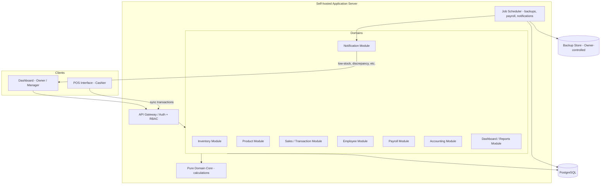
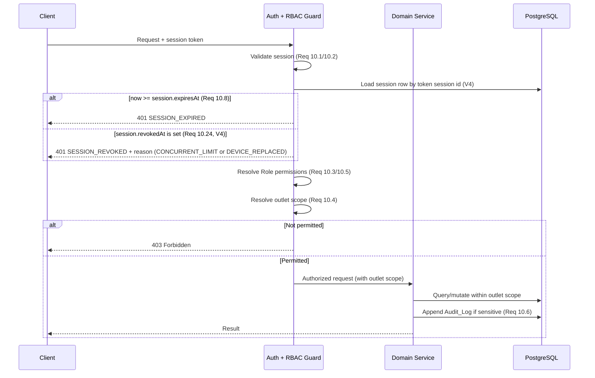
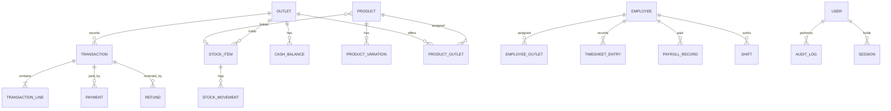

# Design Document

**Version:** V4 (see CHANGELOG.md)

## Overview

This document describes the technical design for a multi-outlet cashier / point-of-sale (POS) system. The primary user is the Business Owner, who monitors sales, manages inventory and products, oversees employees and payroll, and tracks finances across multiple outlets from a centralised dashboard. Outlet Managers oversee daily operations within assigned outlets, and Cashiers process customer transactions through a dedicated POS interface.

The design prioritises four concerns that recur throughout the requirements:

1. **Transaction integrity and idempotency** — transactions must persist atomically (Requirement 12), and duplicate submissions carrying the same identifier must collapse to a single record (Requirements 4.10, 12.2).
2. **Stock consistency** — selling deducts linked stock, refunding restores it, and concurrent sales must not lose updates or oversell (Requirements 2.6, 3.6, 11.1).
3. **Role-based access scoped by outlet** — Business Owners see everything; Managers and Cashiers are confined to assigned outlets (Requirement 10).
4. **Data ownership and recoverability** — data lives on infrastructure the Business Owner controls, with automated backup and point-in-time restore (Requirement 14).

### Key Design Decisions

| Decision | Rationale |
| --- | --- |
| Monolithic modular backend (not microservices) | A single deployable server is simpler to self-host (Req 14.1) and keeps multi-domain transactions (sale + stock + accounting) within one database transaction boundary, directly supporting atomicity (Req 12.3). |
| Relational database (PostgreSQL) with ACID transactions | Financial and inventory correctness depend on serialisable/row-locked writes. A relational engine gives us transactions, unique constraints for idempotency (Req 12.2), and strong referential integrity. |
| Idempotency via a client-supplied `transaction_uid` with a unique constraint | Lets the POS safely retry on a flaky connection (Req 4.10, 12.2) without the server inferring intent. |
| Offline-tolerant POS with server-side sync | The POS confirms locally fast (Req 11.3) and syncs transactions to the central server within the 60s visibility window (Req 3.2). |
| Pure domain layer separated from I/O | Calculation logic (totals, change, payroll, valuation) is written as pure functions so it can be exhaustively property-tested independent of the database. |

### Technology Stack

- **Language / Runtime:** TypeScript on Node.js (shared types between POS client and server; strong typing for money and domain models).
- **Backend framework:** NestJS (modular DI structure maps cleanly onto the requirement domains).
- **Database:** PostgreSQL 15+ with a query builder / ORM (Prisma) for migrations and typed access.
- **POS client:** A single-page web/desktop app (React) with a local persistence queue (IndexedDB) for offline tolerance.
- **Client styling (V3):** Dashboard and POS share one theme package (`@app/theme`) that exports CSS custom properties and a typed TypeScript theme object generated from the same token source. Components reference tokens only (see Visual Theme and Design Tokens).
- **Background jobs:** A scheduler (e.g., BullMQ on Redis) for automated backups, notification dispatch, and payroll batch runs.
- **Property-based testing:** `fast-check` with the project's test runner (Vitest).

## Architecture

### High-Level Architecture



### Layered Structure

Each domain module is organised into three layers:

1. **Controller / API layer** — handles HTTP, authentication, request validation, and RBAC enforcement. Produces the error responses defined in Error Handling.
2. **Service layer** — orchestrates use cases, manages database transactions, and enforces cross-entity invariants (e.g., stock deduction on sale).
3. **Pure domain core** — side-effect-free functions for all calculations: cart totals and change, payroll, inventory valuation, expected cash balance, discrepancy detection. This layer never touches I/O and is the primary target for property-based tests.

### Request Lifecycle and RBAC

Every authenticated request passes through a central authorization guard:



The guard injects an **outlet scope** (`all` for Business Owner, or an explicit set of outlet IDs for Managers and Cashiers). Every scoped query filters on this set so that outlet isolation is enforced centrally rather than per-endpoint.

### Transaction Sync and POS Flow

```mermaid
sequenceDiagram
    participant Cashier
    participant POS as POS Client
    participant Local as Local Queue
    participant API
    participant DB

    Cashier->>POS: Complete sale
    POS->>POS: Compute totals/change (pure core)
    POS->>Local: Persist with transaction_uid
    POS-->>Cashier: Receipt (< 2s, Req 11.3)
    loop Sync (target < 60s, Req 3.2)
        Local->>API: POST transaction (transaction_uid)
        alt uid already recorded
            API-->>Local: Return original record (Req 4.10 / 12.2)
        else new
            API->>DB: BEGIN; insert tx; deduct stock; record income; COMMIT (Req 12.3)
            API-->>Local: Confirmed record
        end
        Local->>Local: Mark synced
    end
```

## Components and Interfaces

The system is decomposed into modules aligned with the requirement domains. Interfaces below are described in TypeScript signature form; monetary amounts use integer minor units (e.g., Indonesian Rupiah cents or smallest denomination) to avoid floating-point drift.

### Inventory Module (Req 1)

```typescript
interface InventoryService {
  createStockItem(outletId: ID, input: StockItemInput): Promise<StockItem>;      // 1.1
  updateStockItem(stockItemId: ID, input: StockItemInput): Promise<StockItem>;   // 1.2
  deleteStockItem(stockItemId: ID): Promise<void>;                               // 1.3
  getStockLevels(outletId: ID): Promise<StockLevel[]>;                           // 1.4
  recordMovement(movement: StockMovementInput): Promise<StockMovement>;          // 1.5
  transferStock(input: StockTransferInput): Promise<StockTransferResult>;        // 1.6
  setLowStockThreshold(stockItemId: ID, threshold: number): Promise<StockItem>;  // 1.7
  getMovementHistory(stockItemId: ID): Promise<StockMovement[]>;                 // 1.10
  getInventoryValuation(outletId: ID): Promise<ValuationReport>;                 // 1.11
}
```

Low-stock (1.8) and out-of-stock (1.9) alerts are raised by an internal `evaluateStockAlerts(stockItem)` function invoked after every quantity change; the function emits alert events consumed by the Notification Module.

### Product Module (Req 2)

```typescript
interface ProductService {
  createProduct(input: ProductInput): Promise<Product>;        // 2.1, rejects dup SKU/barcode 2.7
  updateProduct(productId: ID, input: ProductInput): Promise<Product>; // 2.2
  deleteProduct(productId: ID): Promise<void>;                 // 2.3
  assignToOutlets(productId: ID, outletIds: ID[]): Promise<void>; // 2.4
  createVariation(productId: ID, input: VariationInput): Promise<ProductVariation>; // 2.5
  getSalesPerformance(filter: PeriodFilter): Promise<ProductPerformance[]>; // 2.8
  getBestSellers(filter: PeriodFilter): Promise<ProductPerformance[]>;      // 2.9
}
```

Stock deduction on sale (2.6) is not a direct method call; it is performed by the Sales Module within the sale transaction for any sold product linked to a stock item.

### Sales / Transaction Module (Req 3, 4, 12)

```typescript
interface SalesService {
  recordTransaction(input: TransactionInput): Promise<Transaction>; // idempotent by uid 4.10/12.2, atomic 12.3
  listTransactions(scope: OutletScope, filter: TransactionFilter): Promise<Transaction[]>; // 3.1, 3.4
  getTransaction(id: ID): Promise<TransactionDetail>;    // 3.3
  requestAdjustment(input: AdjustmentRequest): Promise<AdjustmentTicket>; // 3.5 requires authorisation
  applyRefund(input: RefundInput): Promise<Refund>;      // 3.6 restores stock, requires auth
  getSalesSummary(filter: PeriodFilter): Promise<SalesSummary>; // 3.7
  generateReceipt(transactionId: ID): Promise<Receipt>;  // 3.8, 4.9
}
```

`recordTransaction` is the integrity-critical path. It runs in a single database transaction that: (a) inserts the transaction keyed on `transaction_uid` with a unique constraint; (b) deducts linked stock with row locks; (c) records income into accounting; (d) commits. A unique-constraint violation on `transaction_uid` is caught and resolved by returning the existing record rather than erroring.

### POS Module (Req 4, 15) — client-side logic

```typescript
interface PosController {
  searchProducts(query: string, outletId: ID): Promise<Product[]>; // 4.1
  updateCart(cart: Cart, op: CartOp): Cart;                         // 4.2 (pure)
  recalculateCart(cart: Cart): CartTotals;                          // 4.3 (pure)
  calculateChange(total: Money, tendered: Money): Money;            // 4.4 (pure)
  validateSplitPayment(total: Money, payments: Payment[]): boolean; // 4.5 (pure)
  openShift(outletId: ID, openingBalance: Money): Promise<Shift>;   // 4.7
  closeShift(shiftId: ID, closingBalance: Money): Promise<ShiftSummary>; // 4.8
  submitTransaction(input: TransactionInput): Promise<Transaction>; // delegates to SalesService
}
```

### Employee Module (Req 5)

```typescript
interface EmployeeService {
  createEmployee(input: EmployeeInput): Promise<Employee>;   // 5.1
  updateEmployee(id: ID, input: EmployeeInput): Promise<Employee>; // 5.2
  assignOutlets(id: ID, outletIds: ID[]): Promise<void>;     // 5.3
  setSchedule(id: ID, schedule: ScheduleInput): Promise<Schedule>; // 5.4
  clock(id: ID, event: 'in' | 'out', at: Timestamp): Promise<TimesheetEntry>; // 5.5, late 5.6, overtime 5.7
  approveAttendanceCorrection(entryId: ID, correction: Correction, approver: ID): Promise<TimesheetEntry>; // 5.8 (audited)
}
```

Late arrival (5.6) and overtime (5.7) are derived by a pure function `classifyAttendance(scheduledShift, clockIn, clockOut)` so the classification can be property-tested.

### Payroll Module (Req 6)

```typescript
interface PayrollService {
  setCompensation(employeeId: ID, comp: Compensation): Promise<void>; // 6.1
  setAdjustments(employeeId: ID, adj: PayrollAdjustments): Promise<void>; // 6.2
  runPayroll(period: PayPeriod): Promise<PayrollBatch>; // 6.3 from comp + approved timesheets
  generateOutputs(batchId: ID): Promise<{ summary: PayrollSummary; payslips: Payslip[] }>; // 6.4
  recordPayment(recordId: ID, amount: Money): Promise<PayrollRecord>; // 6.5 recalcs outstanding
  getHistory(filter: PeriodFilter): Promise<PayrollRecord[]>; // 6.6
}
```

`calculatePayrollRecord(compensation, adjustments, timesheet)` is a pure function — the core of property testing for payroll.

### Accounting Module (Req 7)

```typescript
interface AccountingService {
  recordEntry(input: FinancialEntryInput): Promise<FinancialEntry>; // 7.1, 7.2
  recordTransactionIncome(tx: Transaction): Promise<void>;          // 7.3 (called by SalesService)
  getCashBalances(scope: OutletScope): Promise<CashBalance[]>;      // 7.4
  recordLiability(input: LiabilityInput): Promise<Liability>;       // 7.5
  generateReport(type: ReportType, filter: PeriodFilter): Promise<FinancialReport>; // 7.6
  recordAdjustment(input: AdjustmentInput, actor: ID): Promise<FinancialEntry>; // 7.7 (audited)
}
```

### Dashboard / Reports Module (Req 8, 11.2)

```typescript
interface DashboardService {
  getOverview(filter: PeriodFilter, scope: OutletScope): Promise<DashboardOverview>; // 8.1
  getSalesPerformance(filter, scope): Promise<SalesPerformanceView>; // 8.2
  getProductPerformance(filter, scope): Promise<ProductPerformanceView>; // 8.3
  getInventoryStatus(scope): Promise<InventoryStatusView>; // 8.4
  getWorkforceStatus(filter, scope): Promise<WorkforceStatusView>; // 8.5
  exportReport(view: ReportView, format: 'PDF' | 'EXCEL' | 'CSV'): Promise<ExportFile>; // 8.8
}
```

To meet the 5-second aggregation target (11.2), dashboard reads use pre-aggregated materialised views / summary tables refreshed on transaction sync rather than scanning raw transactions on each request.

### Notification Module (Req 9, 14.4)

```typescript
interface NotificationService {
  notifyLowStock(stockItem, recipients): Promise<void>;      // 9.1
  notifyOutOfStock(stockItem, recipients): Promise<void>;    // 9.2
  notifyUnusualActivity(refundOrCorrection): Promise<void>;  // 9.3
  notifyCashDiscrepancy(shift): Promise<void>;               // 9.4
  notifyAttendanceIssue(entry): Promise<void>;               // 9.5
  notifyPendingPayment(obligation): Promise<void>;           // 9.6
  notifyBackupFailure(job): Promise<void>;                   // 14.4
}
```

Recipient resolution is a pure function `resolveRecipients(event, outlet)` → `{ businessOwner, outletManager? }`.

### Security / Access Module (Req 10)

```typescript
interface AccessService {
  authenticate(credentials, deviceId?: string): Promise<Session>; // 10.1, 10.2, 10.15-10.23 (V4)
  authorize(session, resource, action): AuthorizationResult;   // 10.3 (pure decision)
  resolveOutletScope(session): OutletScope;                    // 10.4 (pure)
  setRolePermissions(roleOrUser, permissions): Promise<void>;  // 10.5
  appendAuditLog(entry: AuditEntry): Promise<void>;            // 10.6
  setBusinessTimezone(tz: IanaTimezone): Promise<void>;        // 10.13 (V2)
  getSessionStatus(sessionId: ID): Promise<SessionStatusResult>; // 10.24-10.27 (V4) GET /session/status
  subscribeSessionEvents(sessionId: ID): EventStream<SessionEvent>; // 10.25, 10.26 (V4) /session/events
}

type RevocationReason = 'CONCURRENT_LIMIT' | 'DEVICE_REPLACED';
type SessionStatusResult =
  | { status: 'ACTIVE' }
  | { status: 'EXPIRED' }
  | { status: 'REVOKED'; reason: RevocationReason };
type SessionEvent = { type: 'SESSION_REVOKED'; sessionId: ID; reason: RevocationReason; revokedAt: Timestamp };

// Pure domain core (V2)
// Returns the next 00:00 in `tz` strictly after `issuedAt`, as a UTC instant.
function computeSessionExpiry(issuedAt: Timestamp, tz: IanaTimezone): Timestamp; // 10.7, 10.11
// Pure decision used by the server guard and the client route guard.
function isSessionExpired(session: Session, now: Timestamp): boolean;            // 10.8, 10.9, 10.10

// Pure domain core (V4)
const MAX_CONCURRENT_SESSIONS = 2; // fixed, not configurable, all roles (10.14)
// Pure decision: which existing sessions survive and which are revoked (with reason) when `newSession` is added.
function applySessionLimit(
  activeSessions: Session[], newSession: Session, now: Timestamp, limit = MAX_CONCURRENT_SESSIONS,
): { kept: Session[]; revoked: Array<{ session: Session; reason: RevocationReason }> }; // 10.15–10.18, 10.21
// Active = revokedAt is null AND now < expiresAt.
function isSessionActive(session: Session, now: Timestamp): boolean;             // 10.14, 10.21
// Returns a UUID v4 string or undefined when the submitted value is missing or malformed.
function parseDeviceId(raw: unknown): string | undefined;                        // 10.22, 10.23
```

#### Daily Session Expiry (V2, Req 10.7–10.13)

Sessions expire at the next Day_Boundary in the configured Business_Timezone, so every user logs in once per business day.

**Server (authoritative).**
- `authenticate` sets `issuedAt = now` and `expiresAt = computeSessionExpiry(now, businessTimezone)`. The timezone is read at login time, so a timezone change only affects new sessions (10.13).
- `computeSessionExpiry` uses an IANA timezone database (e.g. `Temporal` / `date-fns-tz`), not fixed UTC offsets, so DST transitions in non-Indonesian zones still resolve to local midnight.
- The guard checks `isSessionExpired(session, serverNow)` before any permission check and returns `401 { code: "SESSION_EXPIRED" }`. This is distinct from `401 INVALID_CREDENTIALS` and `403 FORBIDDEN`, so clients know to re-authenticate rather than show a permission error.
- There is no sliding renewal or refresh token that extends a session past the Day_Boundary.

**Dashboard client (immediate redirect, 10.9/10.10).**
- The login response returns `expiresAt` and `serverNow`. The client stores `clockOffset = serverNow - Date.now()` so a wrong device clock cannot extend or shorten the session.
- A `useSessionExpiry` hook schedules a timer for `expiresAt - (Date.now() + clockOffset)`. On fire it clears the stored session and navigates to `/login?returnTo=<current route>`.
- Browser timers are throttled in background tabs and paused while a device sleeps, so the hook also re-checks `isSessionExpired` on `visibilitychange`, `focus`, `online`, and every 30 seconds. Whichever fires first after the boundary triggers the redirect.
- A global HTTP interceptor treats any `401 SESSION_EXPIRED` response the same way, covering missed client checks.
- A route guard on every Dashboard route runs `isSessionExpired` before render, so back-button or deep-link navigation lands on the Login_Page until the user re-authenticates (10.10).
- Session state is broadcast across tabs (`BroadcastChannel` / `storage` event), so every open Dashboard tab redirects together.
- After successful re-authentication, the client returns to `returnTo` if it is a same-origin Dashboard path.

**POS client (10.12).**
- The POS applies the same expiry and redirect, but the local IndexedDB transaction queue is keyed by outlet and device, not by session. It is never cleared on expiry or logout.
- Sync requests that receive `401 SESSION_EXPIRED` leave items in the queue. Sync resumes after the next successful login. Idempotency via `transaction_uid` (Req 4.10/12.2) makes the retried submissions safe.

#### Concurrent Session Limit and Device Identity (V4, Req 10.14-10.29)

Each user may hold at most `MAX_CONCURRENT_SESSIONS = 2` Active_Sessions and at most 1 Active_Session per Device_Identifier (10.14). The limit is a fixed constant, applies to every Role, and is counted per `userId` across all devices and clients (Dashboard and POS_Interface together). It is not configurable.

**Device identity (10.16, 10.22, 10.23).**
- The client generates a random UUID v4 `deviceId` once and persists it. Dashboard: `localStorage`, with a first-party cookie as fallback if storage is unavailable. POS app: installation storage. The client sends it in every login request.
- The server treats `deviceId` as a hint, never as identity. It is always scoped to the authenticated `userId`, validated for format (UUID v4 via `parseDeviceId`), and never used for authorisation or to look up another user's data. All session queries filter on `userId` first.
- Missing or malformed `deviceId`: the server generates a fresh UUID v4 for that session (10.22). The login is treated as a new Device and the 2-session limit still applies.
- Clearing storage, using a private window, or forging a value only creates a new Device. It can never raise a user above 2 Active_Sessions, because the cap is evaluated on sessions, not on devices (10.23). A forged value equal to another user's `deviceId` has no effect, since lookups are scoped to the caller's `userId`.
- Known limitation: device identity is per client installation, not per physical machine. One browser profile is one Device and its tabs share the same session. A different browser or a different browser profile on the same computer is a different Device.

**Session storage.**
- Sessions are persisted server-side in a `sessions` table. Stateless-only tokens are insufficient because revocation must be enforceable before expiry.
- A session is Active when `revokedAt` is null and `now < expiresAt`.
- Index on `(userId, issuedAt, id)` restricted to rows with `revokedAt IS NULL`, to load a user's sessions in revocation order.
- Partial unique index on `(userId, deviceId) WHERE revokedAt IS NULL`. It is a database backstop for the "1 Active_Session per Device_Identifier" rule (10.14, 10.19).
- Expiry is time-based, so an expired row still has `revokedAt IS NULL` and would hold the unique slot. Chosen approach: the login transaction closes every non-revoked row for the same `(userId, deviceId)` before inserting the new row. A row that was still active is closed with `revokedReason = 'DEVICE_REPLACED'` and is notified and audited. A row that had already expired is closed with `revokedAt = now` and `revokedReason = NULL`. This is a silent housekeeping close: no event, no audit entry, and requests carrying it still get `SESSION_EXPIRED` because the guard checks expiry first. This keeps one clean rule: the unique index is only ever violated by a bug, never by normal expiry.
- The token carries only the session id. The guard validates it against the table on every request.
- `deviceLabel` (from user agent / client type) is informational and used for audit and support. Counting uses `deviceId` and `userId` only.
- Revoked and expired rows are retained for audit. A cleanup job may purge them after a retention period. It never touches the Audit_Log.

**Pure decision function.** `applySessionLimit(activeSessions, newSession, now, limit = 2)`:
1. Drops sessions that are expired or revoked at `now` (10.21).
2. Device replacement: every remaining session whose `deviceId` equals `newSession.deviceId` is revoked with reason `DEVICE_REPLACED` (10.16). These sessions do not count toward the limit.
3. Limit: sort the other remaining sessions by `(issuedAt asc, id asc)` (10.17, 10.18) and revoke from the front with reason `CONCURRENT_LIMIT` until `remaining + 1 <= limit`.
4. Returns `{ kept, revoked: [{ session, reason }] }`. It does no I/O, so it is property-testable.

**Atomic login (10.19, 10.20, 10.29).** `authenticate` works in this order:
1. Verify credentials. A failure returns `401 INVALID_CREDENTIALS` before any session row is read or written, so existing sessions are untouched (10.20).
2. Resolve `deviceId = parseDeviceId(input) ?? randomUUID()` (10.22).
3. Open one DB transaction.
4. Take a per-user lock: `SELECT ... FOR UPDATE` on the user row, or `pg_advisory_xact_lock(hash(userId))`.
5. Load all rows with `revokedAt IS NULL` for this `userId` (active and expired) and call `applySessionLimit` on the active ones.
6. Mark each revoked session with `revokedAt = now`, `revokedReason`, and `revokedBySessionId = newSession.id`. Silently close expired rows for the same `deviceId` as described above.
7. Insert the new session with `deviceId` and `expiresAt = computeSessionExpiry(now, businessTimezone)`.
8. Append one Audit_Log entry per revocation with reason, `userId`, `deviceId`, `revokedSessionId`, `newSessionId`, and timestamp (10.29).
9. Commit, then publish `{ type: 'SESSION_REVOKED', sessionId, reason }` for each revoked session.

The lock serialises concurrent logins by the same user, whether from the same device or different devices, so the counts never exceed 2 per user or 1 per device. The partial unique index is a second line of defence. If the transaction fails, nothing is revoked and no session is created.

**Guard.** After the expiry check, the guard checks `revokedAt` and responds `401 { code: "SESSION_REVOKED", reason }` where `reason` is `CONCURRENT_LIMIT` or `DEVICE_REPLACED`. This is distinct from `SESSION_EXPIRED`, `INVALID_CREDENTIALS`, and `403 FORBIDDEN` (10.24). No operation is performed.

**Dashboard client (redirect within 5 seconds, 10.25-10.27).**
- Push: the client opens a per-session channel (Server-Sent Events, or WebSocket as an alternative) at `/session/events`. The server sends `SESSION_REVOKED` with its reason right after the login transaction commits.
- Polling fallback: while the tab is visible, the client calls `GET /session/status` every 3 seconds, and the channel is treated as down when it is closed or errors. The response is `{ status: 'REVOKED', reason }` for a revoked session. With a 3-second interval plus request latency under normal load, redirect stays within the 5-second bound even with push down. Polling pauses when the tab is hidden.
- Additional checks fire on `visibilitychange`, `focus`, and `online`. The global 401 interceptor maps `SESSION_REVOKED` exactly like `SESSION_EXPIRED`, keeping the reason.
- On any trigger the client clears the session and navigates by reason, shown by a shared status component (icon + text + border per the theme status rules, never colour alone):

| Reason | Route | Message |
| --- | --- | --- |
| `CONCURRENT_LIMIT` (10.25) | `/login?reason=signed_in_elsewhere` | "Your account was signed in on another device." |
| `DEVICE_REPLACED` (10.26) | `/login?reason=signed_in_again` | "You were signed out because you signed in again on this device." |

- Route guard (10.27): every Dashboard route also checks revocation state, so back-button or deep-link navigation lands on the Login_Page.
- Cross-tab: state is broadcast with `BroadcastChannel` / `storage`, so other tabs of the same browser redirect together.
- Own-login rule: the tab that performs a new login must not be redirected by the revocation of its own previous session. The client stores the new session id before or while the old session's event is processed, and it ignores any revocation event or status whose `sessionId` is not the currently stored session id. Other tabs adopt the new session id through the same broadcast.

**POS client (10.28).** Same as expiry. The IndexedDB queue is keyed by outlet and device, never by session, and is not cleared on revocation. Sync that receives `401 SESSION_REVOKED` leaves items queued and resumes after re-login. `transaction_uid` idempotency (Req 4.10/12.2) makes retries safe.

**Edge cases.**
- Offline revoked device: the device learns of revocation on its next request or reconnect, since push and polling both need connectivity. The POS may keep recording locally into its queue while offline. Those transactions sync after re-login.
- Same-device re-login never evicts another device's session. Example: login on Device A, then B, then A again. The second A login replaces A's first session (DEVICE_REPLACED) and B stays, so the user holds 2 Active_Sessions.
- Ping-pong: only possible across 3 or more distinct Devices. If a revoked device logs in again immediately, that login revokes whichever of the other two sessions is oldest. This is expected behaviour of the limit and not a defect. Each event is visible in the Audit_Log with its reason.
- Revocation under the limit is based on `issuedAt`, not last activity. A busy older session is still the one revoked.
- Storage cleared on a device: its next login is a new Device. The old session stays active until it expires or is revoked by the limit, and it counts toward the 2-session cap meanwhile.

### Backup / Recovery Module (Req 14)

```typescript
interface BackupService {
  runScheduledBackup(): Promise<BackupResult>;   // 14.2 (scheduled job)
  listBackups(): Promise<BackupMeta[]>;
  restore(backupId: ID): Promise<RestoreResult>; // 14.3
}
```

A failed backup (14.4) triggers `NotificationService.notifyBackupFailure`.

## Visual Theme and Design Tokens (V3)

The Dashboard, POS_Interface, and Login_Page share one brand theme: primary `#990000` (deep red), secondary `#000000` (black), accent `#FFFFFF` (white). This is a presentation-only change. It adds no new requirements and does not alter any domain, API, or data behaviour.

### Single Source of Truth

Tokens are defined once in the shared theme package and emitted in two forms:

- CSS custom properties on `:root` for styling.
- A typed `Theme` object (`as const`) for logic that needs raw values, such as chart libraries and PDF export.

Components must reference tokens only. Ad hoc hex values in components are not allowed and are flagged by a lint rule (for example a stylelint/ESLint rule banning colour literals outside the theme package).

| Token | Value | Purpose |
| --- | --- | --- |
| `--color-primary` | `#990000` | Brand colour for primary actions |
| `--color-primary-hover` | `#7A0000` | Hover state of primary elements |
| `--color-primary-pressed` | `#5C0000` | Pressed/active state of primary elements |
| `--color-primary-tint` | `#FBEAEA` | Subtle primary-tinted background (selected row, active nav on light surfaces) |
| `--color-secondary` | `#000000` | Text, top bar, sidebar, strong borders |
| `--color-accent` | `#FFFFFF` | Page/card surfaces, and text/icons on primary or secondary backgrounds |
| `--color-surface` | `#FFFFFF` | Cards, dialogs, inputs |
| `--color-surface-muted` | `#F5F5F5` | Page background, table zebra rows |
| `--color-border` | `#D4D4D4` | Default dividers and input borders |
| `--color-border-strong` | `#000000` | Emphasised borders, error/alert border pattern |
| `--color-text` | `#000000` | Body text on light surfaces |
| `--color-text-muted` | `#595959` | Secondary text on light surfaces |
| `--color-text-on-dark` | `#FFFFFF` | Text and icons on primary or secondary backgrounds |
| `--color-success` | `#1B5E20` | Success state (dark green, distinct from primary) |
| `--color-warning` | `#8A5A00` | Warning state (dark amber, distinct from primary) |
| `--focus-ring-inner` / `--focus-ring-outer` | `#FFFFFF` / `#000000` | Two-tone focus ring |

Derived values (hover, pressed, tint, muted, success, warning) are fixed explicit tokens, not computed at runtime, so they can be contrast-tested. The values above are the proposed starting set; the automated contrast test (see Testing Note) is the authority and any token that fails is adjusted in the theme package only.

### Role Assignment

| Colour | Used for |
| --- | --- |
| Primary | Primary buttons, active navigation item, key actions (for example Complete Sale, Clock in/out), links, and focus accents on light surfaces |
| Secondary (black) | Text, header/top bar and sidebar backgrounds, strong borders |
| Accent (white) | Page and card surfaces, and text/icons placed on primary or secondary backgrounds |

Primary buttons use `--color-primary` with `--color-text-on-dark` text, `-hover` and `-pressed` for states. Secondary buttons are white with a `--color-border-strong` border and black text.

### Contrast and Accessibility

Approximate contrast ratios, computed with the WCAG relative-luminance formula:

| Foreground on background | Ratio | Result |
| --- | --- | --- |
| `#990000` on `#FFFFFF` | about 8.9:1 | Passes AA and AAA for normal text |
| `#FFFFFF` on `#990000` | about 8.9:1 | Passes AA and AAA for normal text |
| `#000000` on `#FFFFFF` | 21:1 | Passes AA and AAA |
| `#990000` on `#000000` | about 2.4:1 | Fails AA |

Rules:

- Primary-coloured text, icons, or borders must never be placed on a secondary (black) background. Use `--color-text-on-dark` (white) there. This applies to the sidebar and top bar, so the active nav item on a black sidebar is shown with a white label plus a white indicator bar or a primary-filled pill with white text, never red text on black.
- Only the foreground/background pairs listed in a `PERMITTED_PAIRS` table in the theme package may be used, and each must meet its minimum ratio (4.5:1 for normal text, 3:1 for large text and UI component boundaries).
- Focus rings are two-tone (white inner ring plus black outer outline) so they are visible on both light and dark surfaces. Focus indicators are never removed.
- Full WCAG validation still requires manual testing with assistive technologies and expert accessibility review. The automated checks cover token pairs only.

### Status Colours and Non-Colour Cues

Because the primary colour is a deep red, a red tone alone cannot signal error or risk. Status UI never relies on colour alone.

- Statuses covered: error, destructive actions, out-of-stock, low-stock, and cash-register discrepancy (Req 1.8, 1.9, 9.4), plus success and warning.
- Semantic tokens `--color-success` and `--color-warning` exist and are visually distinct from primary. There is no separate bright-red error token. Error and destructive states use the primary and secondary tokens plus the cues below.
- Every status renders as icon + text label + border pattern:
  - Error / out-of-stock / discrepancy: error icon, explicit label (for example "Out of stock"), a `--color-border-strong` 2px border with a solid left bar, on a `--color-primary-tint` background.
  - Low-stock / warning: warning icon, label (for example "Low stock"), a dashed border in `--color-warning`.
  - Success: check icon, label, a `--color-success` border.
- Destructive buttons carry an icon and a verb label (for example "Delete item") and require a confirmation dialog, rather than depending on colour.
- Form field errors use an icon, a message linked through `aria-describedby`, and a border pattern, supporting Req 15.2 (descriptive invalid-value messages).

### Charts, Reports, Exports, and Receipts

- **Charts:** the series palette is derived from tokens: primary, black, mid-greys, and primary-tint, with white labels on dark fills. Series are also distinguished by pattern fills (hatch, dots, solid), direct data labels or legends with markers, and distinct line styles, so charts remain readable without colour perception.
- **PDF exports:** use a theme header (black or primary header band with white title text and logo) and token-based table styling. The PDF renderer reads values from the typed `Theme` object.
- **Excel / CSV exports:** CSV carries no styling. Excel header rows may use the primary fill with white bold text. Data is never encoded by colour alone.
- **Receipts (printed and shared):** black on white only, with no tinted or coloured backgrounds, for thermal-printer and print legibility. The brand colour may appear only in an optional on-screen receipt preview header, never in the printed or shared output.

### Central Application

- Theming is applied centrally through the shared theme provider (CSS variables on `:root`, typed theme in a React context). Per-component colour overrides are not allowed.
- The Login_Page and both clients load the same theme package, so Req 10.9 and 10.10 redirects land on a visually consistent Login_Page.
- Changing a brand value means editing the token source only.

### Testing Note

A Vitest unit test in the theme package computes WCAG contrast ratios for every entry in `PERMITTED_PAIRS` and asserts the minimum ratio (4.5:1 normal text, 3:1 large text and UI boundaries). It also asserts that a forbidden pair, primary on secondary, is not present in `PERMITTED_PAIRS`. A lint check asserts that no colour literals appear outside the theme package. Visual and assistive-technology checks are manual.

## Data Models

Monetary fields are integers in minor currency units. Quantities are integers. All records carry `createdAt`/`updatedAt`; outlet-scoped records carry `outletId`.



### Core Entities

```typescript
type ID = string;
type Money = number;      // integer minor units
type Quantity = number;   // integer

interface Outlet {
  id: ID; name: string; address?: string; active: boolean;
}

interface StockItem {
  id: ID; outletId: ID; name: string;
  quantity: Quantity;          // never negative (invariant)
  unitCost: Money;             // for valuation (1.11)
  lowStockThreshold: Quantity; // (1.7)
}

interface StockMovement {
  id: ID; stockItemId: ID; type: 'IN' | 'OUT' | 'ADJUST' | 'TRANSFER_IN' | 'TRANSFER_OUT' | 'SALE' | 'REFUND';
  quantityDelta: number;       // signed; sum of deltas + initial == current quantity
  occurredAt: Timestamp; originatingUserId: ID; note?: string;
}

interface Product {
  id: ID; name: string; category: string;
  price: Money; cost: Money;
  sku: string;        // unique (2.7)
  barcode: string;    // unique (2.7)
  linkedStockItemId?: ID; // (2.6)
}

interface ProductVariation { id: ID; productId: ID; name: string; priceDelta: Money; sku?: string; barcode?: string; }
interface ProductOutlet { productId: ID; outletId: ID; } // availability (2.4)

interface Transaction {
  id: ID; transactionUid: string;  // client-supplied, UNIQUE (idempotency 4.10/12.2)
  outletId: ID; cashierId: ID; shiftId: ID;
  lines: TransactionLine[]; payments: Payment[];
  subtotal: Money; discountTotal: Money; taxTotal: Money; total: Money;
  status: 'COMPLETED' | 'REFUNDED' | 'PARTIALLY_REFUNDED';
  createdAt: Timestamp;
}

interface TransactionLine { productId: ID; variationId?: ID; quantity: Quantity; unitPrice: Money; lineDiscount: Money; lineTotal: Money; }
interface Payment { method: 'CASH' | 'BANK_TRANSFER' | 'DEBIT' | 'CREDIT' | 'QRIS'; amount: Money; tendered?: Money; change?: Money; }

interface Refund {
  id: ID; transactionId: ID; lines: RefundLine[];
  amount: Money; authorisedBy: ID; createdAt: Timestamp;
}
interface RefundLine { productId: ID; quantity: Quantity; amount: Money; }

interface Shift {
  id: ID; cashierId: ID; outletId: ID;
  openingBalance: Money; closingBalance?: Money;
  expectedBalance?: Money;  // opening + cash sales - cash refunds (for 9.4)
  openedAt: Timestamp; closedAt?: Timestamp;
}
```

### Employee, Payroll, Accounting Entities

```typescript
interface Employee { id: ID; name: string; role: Role; active: boolean; }
type Role = 'BUSINESS_OWNER' | 'OUTLET_MANAGER' | 'CASHIER';
interface EmployeeOutlet { employeeId: ID; outletId: ID; } // (5.3)

interface Schedule { id: ID; employeeId: ID; shiftStart: TimeOfDay; shiftEnd: TimeOfDay; days: Weekday[]; }

interface TimesheetEntry {
  id: ID; employeeId: ID; date: DateOnly;
  clockIn?: Timestamp; clockOut?: Timestamp;
  lateMinutes: number;      // derived (5.6)
  overtimeMinutes: number;  // derived (5.7)
  absent: boolean;
  approvedBy?: ID;          // (5.8)
}

interface Compensation { employeeId: ID; basis: 'SALARY' | 'HOURLY' | 'DAILY'; baseAmount: Money; }
interface PayrollAdjustments { employeeId: ID; allowances: Money; bonuses: Money; overtimeRate: Money; deductions: Money; }

interface PayrollRecord {
  id: ID; employeeId: ID; period: PayPeriod;
  gross: Money; overtimePay: Money; allowances: Money; bonuses: Money; deductions: Money;
  net: Money;                 // gross + overtime + allowances + bonuses - deductions
  paidAmount: Money;          // (6.5)
  outstanding: Money;         // net - paidAmount (6.5)
}

interface FinancialEntry {
  id: ID; outletId?: ID; type: 'INCOME' | 'EXPENSE';
  amount: Money; date: DateOnly; category: ExpenseCategory | 'SALES_REVENUE';
  isAdjustment: boolean; actorId?: ID;  // (7.7)
}
type ExpenseCategory = 'RENT' | 'UTILITIES' | 'SALARIES' | 'STOCK_PURCHASES' | 'OPERATIONAL';

interface Liability { id: ID; counterparty: string; amount: Money; dueDate: DateOnly; paidAmount: Money; }
interface CashBalance { outletId: ID; balance: Money; }

interface AuditLog { id: ID; userId: ID; action: string; recordType: string; recordId: ID; timestamp: Timestamp; }

// V2: expiresAt = computeSessionExpiry(issuedAt, businessTimezone) — next 00:00 in Business_Timezone.
// V4: persisted in the `sessions` table. Active = revokedAt is null AND now < expiresAt.
// Index on (userId, issuedAt, id) WHERE revokedAt IS NULL. Ties in issuedAt are broken by lowest id (10.18).
// Partial unique index on (userId, deviceId) WHERE revokedAt IS NULL (10.14, 10.19).
interface Session {
  id: ID;                                  // V4
  userId: ID; role: Role; outletIds: ID[] | 'ALL';
  deviceId: string;                        // V4: UUID v4, client-supplied hint or server-generated (10.22); scoped to userId
  issuedAt: Timestamp; expiresAt: Timestamp;
  deviceLabel?: string;                    // V4: informational only, never used for counting
  revokedAt?: Timestamp;                   // V4
  revokedReason?: 'CONCURRENT_LIMIT' | 'DEVICE_REPLACED'; // V4: unset when an expired row is silently closed on re-login
  revokedBySessionId?: ID;                 // V4: the new session that caused the revocation
}
// V2: single-row business configuration; businessTimezone is an IANA name, default 'Asia/Jakarta'.
interface BusinessSettings { businessTimezone: IanaTimezone; updatedAt: Timestamp; updatedBy: ID; }
type IanaTimezone = string;
type OutletScope = { kind: 'ALL' } | { kind: 'SET'; outletIds: ID[] };
```

### Key Invariants (enforced in schema + domain core)

- `StockItem.quantity >= 0` at all times (no overselling).
- Sum of a stock item's `StockMovement.quantityDelta` plus its initial quantity equals its current `quantity`.
- `Transaction.total == subtotal - discountTotal + taxTotal`, and `sum(line.lineTotal) == subtotal`.
- `Transaction.transactionUid` is globally unique (database unique constraint).
- `PayrollRecord.net == gross + overtimePay + allowances + bonuses - deductions` and `outstanding == net - paidAmount`.
- For a cash-only shift, `expectedBalance == openingBalance + cashSales - cashRefunds`.
- *(V2)* For every Session, `issuedAt < expiresAt`, `expiresAt` is a local 00:00 in the Business_Timezone, and no local 00:00 lies strictly between `issuedAt` and `expiresAt`.
- *(V4)* For every user and any time `t`, the count of Active_Sessions is at most 2 and at most 1 per `deviceId` (10.14, 10.23).
- *(V4)* After a successful login, the new Session is active (10.15).
- *(V4)* Every Active_Session of the same user on the same `deviceId` as the new login is revoked with reason `DEVICE_REPLACED` (10.16).
- *(V4)* A `CONCURRENT_LIMIT` revocation occurs only when the user holds 2 Active_Sessions on other Devices, and exactly the one with the earliest `(issuedAt, id)` is revoked (10.17, 10.18). Fewer than 2 other-Device sessions revoke nothing under the limit.
- *(V4)* A failed login leaves all of the user's sessions unchanged (10.20).
- *(V4)* A submitted `deviceId` never affects another user's sessions (10.23).

### Session Limit Testing Note (V4)

- Property test P16 for `applySessionLimit` (Req 10.14-10.18, 10.21): for any set of sessions (mixed active, expired, revoked, mixed deviceIds) and any new session:
  - `kept + new` has at most 2 active sessions and at most 1 per `deviceId`.
  - Every active session with the new session's `deviceId` is revoked with reason `DEVICE_REPLACED`.
  - The `CONCURRENT_LIMIT` revocations are exactly the earliest remaining sessions by `(issuedAt, id)`, and are chosen only when the remaining other-device sessions would exceed the limit.
  - Fewer than 2 other-device active sessions produce no `CONCURRENT_LIMIT` revocation.
  - Expired or revoked inputs are never counted or revoked.
  - The result is deterministic on `issuedAt` ties (lowest id first).
  Runs with `fast-check`, 100+ iterations.
- Unit tests for `parseDeviceId`: accepts UUID v4, rejects missing, empty, non-string, and malformed values (10.22).
- Concurrency integration tests against a real PostgreSQL (10.19, 10.29):
  - Simultaneous logins by one user from the same device leave 1 active session for that device.
  - Simultaneous logins from different devices never leave more than 2 active sessions.
  - Every revocation has one Audit_Log entry with reason, deviceId, revokedSessionId, newSessionId, userId, and timestamp.
  - Re-login on a device whose previous row has expired is not blocked by the unique index, and the expired row is closed without an event or audit entry.
- Device id abuse tests (10.22, 10.23): a missing or forged `deviceId` cannot push a user above 2 active sessions, and a `deviceId` belonging to another user's session does not touch that user's sessions.
- Guard test (10.24): a revoked session gets `401 { code: 'SESSION_REVOKED', reason }`, distinct from `SESSION_EXPIRED` and `INVALID_CREDENTIALS`, and no operation runs. `GET /session/status` returns `{ status: 'REVOKED', reason }`.
- Dashboard client tests with fake timers (10.25-10.27):
  - Push-triggered redirect, polling fallback with push down, and redirect within 5 seconds.
  - `CONCURRENT_LIMIT` goes to `/login?reason=signed_in_elsewhere` with the "another device" message. `DEVICE_REPLACED` goes to `/login?reason=signed_in_again` with the "signed in again on this device" message. Both render icon + text.
  - Route guard block and cross-tab broadcast.
  - A revocation event or status for a stale session id (not the currently stored one) is ignored, so the tab that performed the new login is not redirected.
- POS test (10.28): queued transactions survive `SESSION_REVOKED` for both reasons and sync after re-login.

