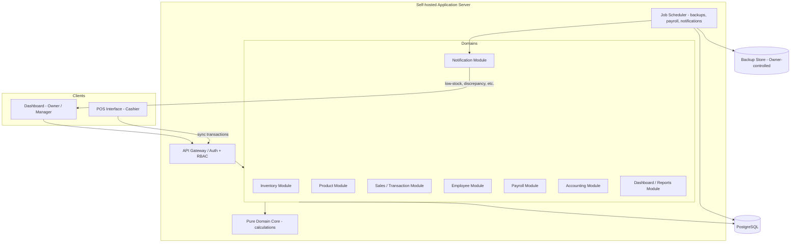
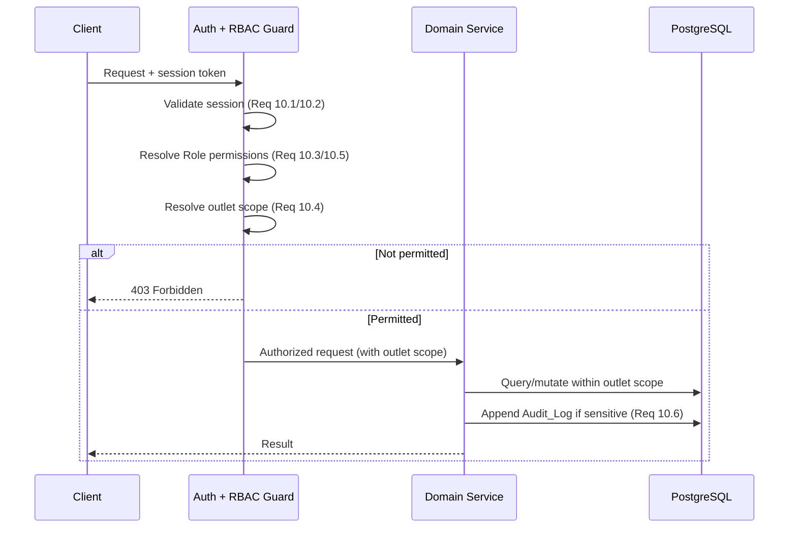
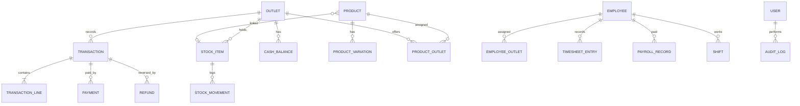

# Design Document

## Overview

This document describes the technical design for a multi-outlet cashier / point-of-sale (POS) system. The primary user is the Business Owner, who monitors sales, manages inventory and products, oversees employees and payroll, and tracks finances across multiple outlets from a centralised dashboard. Outlet Managers oversee daily operations within assigned outlets, and Cashiers process customer transactions through a dedicated POS interface.

The design prioritises four concerns that recur throughout the requirements:

1. **Transaction integrity and idempotency** — transactions must persist atomically (Requirement 12), and duplicate submissions carrying the same identifier must collapse to a single record (Requirements 4.10, 12.2).
2. **Stock consistency** — selling deducts linked stock, refunding restores it, and concurrent sales must not lose updates or oversell (Requirements 2.6, 3.6, 11.1).
3. **Role-based access scoped by outlet** — Business Owners see everything; Managers and Cashiers are confined to assigned outlets (Requirement 10).
4. **Data ownership and recoverability** — data lives on infrastructure the Business Owner controls, with automated backup and point-in-time restore (Requirement 14).

### Key Design Decisions

| Decision | Rationale |
| --- | --- |
| Monolithic modular backend (not microservices) | A single deployable server is simpler to self-host (Req 14.1) and keeps multi-domain transactions (sale + stock + accounting) within one database transaction boundary, directly supporting atomicity (Req 12.3). |
| Relational database (PostgreSQL) with ACID transactions | Financial and inventory correctness depend on serialisable/row-locked writes. A relational engine gives us transactions, unique constraints for idempotency (Req 12.2), and strong referential integrity. |
| Idempotency via a client-supplied `transaction_uid` with a unique constraint | Lets the POS safely retry on a flaky connection (Req 4.10, 12.2) without the server inferring intent. |
| Offline-tolerant POS with server-side sync | The POS confirms locally fast (Req 11.3) and syncs transactions to the central server within the 60s visibility window (Req 3.2). |
| Pure domain layer separated from I/O | Calculation logic (totals, change, payroll, valuation) is written as pure functions so it can be exhaustively property-tested independent of the database. |

### Technology Stack

- **Language / Runtime:** TypeScript on Node.js (shared types between POS client and server; strong typing for money and domain models).
- **Backend framework:** NestJS (modular DI structure maps cleanly onto the requirement domains).
- **Database:** PostgreSQL 15+ with a query builder / ORM (Prisma) for migrations and typed access.
- **POS client:** A single-page web/desktop app (React) with a local persistence queue (IndexedDB) for offline tolerance.
- **Background jobs:** A scheduler (e.g., BullMQ on Redis) for automated backups, notification dispatch, and payroll batch runs.
- **Property-based testing:** `fast-check` with the project's test runner (Vitest).

## Architecture

### High-Level Architecture



### Layered Structure

Each domain module is organised into three layers:

1. **Controller / API layer** — handles HTTP, authentication, request validation, and RBAC enforcement. Produces the error responses defined in Error Handling.
2. **Service layer** — orchestrates use cases, manages database transactions, and enforces cross-entity invariants (e.g., stock deduction on sale).
3. **Pure domain core** — side-effect-free functions for all calculations: cart totals and change, payroll, inventory valuation, expected cash balance, discrepancy detection. This layer never touches I/O and is the primary target for property-based tests.

### Request Lifecycle and RBAC

Every authenticated request passes through a central authorization guard:



The guard injects an **outlet scope** (`all` for Business Owner, or an explicit set of outlet IDs for Managers and Cashiers). Every scoped query filters on this set so that outlet isolation is enforced centrally rather than per-endpoint.

### Transaction Sync and POS Flow

```mermaid
sequenceDiagram
    participant Cashier
    participant POS as POS Client
    participant Local as Local Queue
    participant API
    participant DB

    Cashier->>POS: Complete sale
    POS->>POS: Compute totals/change (pure core)
    POS->>Local: Persist with transaction_uid
    POS-->>Cashier: Receipt (< 2s, Req 11.3)
    loop Sync (target < 60s, Req 3.2)
        Local->>API: POST transaction (transaction_uid)
        alt uid already recorded
            API-->>Local: Return original record (Req 4.10 / 12.2)
        else new
            API->>DB: BEGIN; insert tx; deduct stock; record income; COMMIT (Req 12.3)
            API-->>Local: Confirmed record
        end
        Local->>Local: Mark synced
    end
```

## Components and Interfaces

The system is decomposed into modules aligned with the requirement domains. Interfaces below are described in TypeScript signature form; monetary amounts use integer minor units (e.g., Indonesian Rupiah cents or smallest denomination) to avoid floating-point drift.

### Inventory Module (Req 1)

```typescript
interface InventoryService {
  createStockItem(outletId: ID, input: StockItemInput): Promise<StockItem>;      // 1.1
  updateStockItem(stockItemId: ID, input: StockItemInput): Promise<StockItem>;   // 1.2
  deleteStockItem(stockItemId: ID): Promise<void>;                               // 1.3
  getStockLevels(outletId: ID): Promise<StockLevel[]>;                           // 1.4
  recordMovement(movement: StockMovementInput): Promise<StockMovement>;          // 1.5
  transferStock(input: StockTransferInput): Promise<StockTransferResult>;        // 1.6
  setLowStockThreshold(stockItemId: ID, threshold: number): Promise<StockItem>;  // 1.7
  getMovementHistory(stockItemId: ID): Promise<StockMovement[]>;                 // 1.10
  getInventoryValuation(outletId: ID): Promise<ValuationReport>;                 // 1.11
}
```

Low-stock (1.8) and out-of-stock (1.9) alerts are raised by an internal `evaluateStockAlerts(stockItem)` function invoked after every quantity change; the function emits alert events consumed by the Notification Module.

### Product Module (Req 2)

```typescript
interface ProductService {
  createProduct(input: ProductInput): Promise<Product>;        // 2.1, rejects dup SKU/barcode 2.7
  updateProduct(productId: ID, input: ProductInput): Promise<Product>; // 2.2
  deleteProduct(productId: ID): Promise<void>;                 // 2.3
  assignToOutlets(productId: ID, outletIds: ID[]): Promise<void>; // 2.4
  createVariation(productId: ID, input: VariationInput): Promise<ProductVariation>; // 2.5
  getSalesPerformance(filter: PeriodFilter): Promise<ProductPerformance[]>; // 2.8
  getBestSellers(filter: PeriodFilter): Promise<ProductPerformance[]>;      // 2.9
}
```

Stock deduction on sale (2.6) is not a direct method call; it is performed by the Sales Module within the sale transaction for any sold product linked to a stock item.

### Sales / Transaction Module (Req 3, 4, 12)

```typescript
interface SalesService {
  recordTransaction(input: TransactionInput): Promise<Transaction>; // idempotent by uid 4.10/12.2, atomic 12.3
  listTransactions(scope: OutletScope, filter: TransactionFilter): Promise<Transaction[]>; // 3.1, 3.4
  getTransaction(id: ID): Promise<TransactionDetail>;    // 3.3
  requestAdjustment(input: AdjustmentRequest): Promise<AdjustmentTicket>; // 3.5 requires authorisation
  applyRefund(input: RefundInput): Promise<Refund>;      // 3.6 restores stock, requires auth
  getSalesSummary(filter: PeriodFilter): Promise<SalesSummary>; // 3.7
  generateReceipt(transactionId: ID): Promise<Receipt>;  // 3.8, 4.9
}
```

`recordTransaction` is the integrity-critical path. It runs in a single database transaction that: (a) inserts the transaction keyed on `transaction_uid` with a unique constraint; (b) deducts linked stock with row locks; (c) records income into accounting; (d) commits. A unique-constraint violation on `transaction_uid` is caught and resolved by returning the existing record rather than erroring.

### POS Module (Req 4, 15) — client-side logic

```typescript
interface PosController {
  searchProducts(query: string, outletId: ID): Promise<Product[]>; // 4.1
  updateCart(cart: Cart, op: CartOp): Cart;                         // 4.2 (pure)
  recalculateCart(cart: Cart): CartTotals;                          // 4.3 (pure)
  calculateChange(total: Money, tendered: Money): Money;            // 4.4 (pure)
  validateSplitPayment(total: Money, payments: Payment[]): boolean; // 4.5 (pure)
  openShift(outletId: ID, openingBalance: Money): Promise<Shift>;   // 4.7
  closeShift(shiftId: ID, closingBalance: Money): Promise<ShiftSummary>; // 4.8
  submitTransaction(input: TransactionInput): Promise<Transaction>; // delegates to SalesService
}
```

### Employee Module (Req 5)

```typescript
interface EmployeeService {
  createEmployee(input: EmployeeInput): Promise<Employee>;   // 5.1
  updateEmployee(id: ID, input: EmployeeInput): Promise<Employee>; // 5.2
  assignOutlets(id: ID, outletIds: ID[]): Promise<void>;     // 5.3
  setSchedule(id: ID, schedule: ScheduleInput): Promise<Schedule>; // 5.4
  clock(id: ID, event: 'in' | 'out', at: Timestamp): Promise<TimesheetEntry>; // 5.5, late 5.6, overtime 5.7
  approveAttendanceCorrection(entryId: ID, correction: Correction, approver: ID): Promise<TimesheetEntry>; // 5.8 (audited)
}
```

Late arrival (5.6) and overtime (5.7) are derived by a pure function `classifyAttendance(scheduledShift, clockIn, clockOut)` so the classification can be property-tested.

### Payroll Module (Req 6)

```typescript
interface PayrollService {
  setCompensation(employeeId: ID, comp: Compensation): Promise<void>; // 6.1
  setAdjustments(employeeId: ID, adj: PayrollAdjustments): Promise<void>; // 6.2
  runPayroll(period: PayPeriod): Promise<PayrollBatch>; // 6.3 from comp + approved timesheets
  generateOutputs(batchId: ID): Promise<{ summary: PayrollSummary; payslips: Payslip[] }>; // 6.4
  recordPayment(recordId: ID, amount: Money): Promise<PayrollRecord>; // 6.5 recalcs outstanding
  getHistory(filter: PeriodFilter): Promise<PayrollRecord[]>; // 6.6
}
```

`calculatePayrollRecord(compensation, adjustments, timesheet)` is a pure function — the core of property testing for payroll.

### Accounting Module (Req 7)

```typescript
interface AccountingService {
  recordEntry(input: FinancialEntryInput): Promise<FinancialEntry>; // 7.1, 7.2
  recordTransactionIncome(tx: Transaction): Promise<void>;          // 7.3 (called by SalesService)
  getCashBalances(scope: OutletScope): Promise<CashBalance[]>;      // 7.4
  recordLiability(input: LiabilityInput): Promise<Liability>;       // 7.5
  generateReport(type: ReportType, filter: PeriodFilter): Promise<FinancialReport>; // 7.6
  recordAdjustment(input: AdjustmentInput, actor: ID): Promise<FinancialEntry>; // 7.7 (audited)
}
```

### Dashboard / Reports Module (Req 8, 11.2)

```typescript
interface DashboardService {
  getOverview(filter: PeriodFilter, scope: OutletScope): Promise<DashboardOverview>; // 8.1
  getSalesPerformance(filter, scope): Promise<SalesPerformanceView>; // 8.2
  getProductPerformance(filter, scope): Promise<ProductPerformanceView>; // 8.3
  getInventoryStatus(scope): Promise<InventoryStatusView>; // 8.4
  getWorkforceStatus(filter, scope): Promise<WorkforceStatusView>; // 8.5
  exportReport(view: ReportView, format: 'PDF' | 'EXCEL' | 'CSV'): Promise<ExportFile>; // 8.8
}
```

To meet the 5-second aggregation target (11.2), dashboard reads use pre-aggregated materialised views / summary tables refreshed on transaction sync rather than scanning raw transactions on each request.

### Notification Module (Req 9, 14.4)

```typescript
interface NotificationService {
  notifyLowStock(stockItem, recipients): Promise<void>;      // 9.1
  notifyOutOfStock(stockItem, recipients): Promise<void>;    // 9.2
  notifyUnusualActivity(refundOrCorrection): Promise<void>;  // 9.3
  notifyCashDiscrepancy(shift): Promise<void>;               // 9.4
  notifyAttendanceIssue(entry): Promise<void>;               // 9.5
  notifyPendingPayment(obligation): Promise<void>;           // 9.6
  notifyBackupFailure(job): Promise<void>;                   // 14.4
}
```

Recipient resolution is a pure function `resolveRecipients(event, outlet)` → `{ businessOwner, outletManager? }`.

### Security / Access Module (Req 10)

```typescript
interface AccessService {
  authenticate(credentials): Promise<Session>;                 // 10.1, 10.2
  authorize(session, resource, action): AuthorizationResult;   // 10.3 (pure decision)
  resolveOutletScope(session): OutletScope;                    // 10.4 (pure)
  setRolePermissions(roleOrUser, permissions): Promise<void>;  // 10.5
  appendAuditLog(entry: AuditEntry): Promise<void>;            // 10.6
}
```

### Backup / Recovery Module (Req 14)

```typescript
interface BackupService {
  runScheduledBackup(): Promise<BackupResult>;   // 14.2 (scheduled job)
  listBackups(): Promise<BackupMeta[]>;
  restore(backupId: ID): Promise<RestoreResult>; // 14.3
}
```

A failed backup (14.4) triggers `NotificationService.notifyBackupFailure`.

## Data Models

Monetary fields are integers in minor currency units. Quantities are integers. All records carry `createdAt`/`updatedAt`; outlet-scoped records carry `outletId`.



### Core Entities

```typescript
type ID = string;
type Money = number;      // integer minor units
type Quantity = number;   // integer

interface Outlet {
  id: ID; name: string; address?: string; active: boolean;
}

interface StockItem {
  id: ID; outletId: ID; name: string;
  quantity: Quantity;          // never negative (invariant)
  unitCost: Money;             // for valuation (1.11)
  lowStockThreshold: Quantity; // (1.7)
}

interface StockMovement {
  id: ID; stockItemId: ID; type: 'IN' | 'OUT' | 'ADJUST' | 'TRANSFER_IN' | 'TRANSFER_OUT' | 'SALE' | 'REFUND';
  quantityDelta: number;       // signed; sum of deltas + initial == current quantity
  occurredAt: Timestamp; originatingUserId: ID; note?: string;
}

interface Product {
  id: ID; name: string; category: string;
  price: Money; cost: Money;
  sku: string;        // unique (2.7)
  barcode: string;    // unique (2.7)
  linkedStockItemId?: ID; // (2.6)
}

interface ProductVariation { id: ID; productId: ID; name: string; priceDelta: Money; sku?: string; barcode?: string; }
interface ProductOutlet { productId: ID; outletId: ID; } // availability (2.4)

interface Transaction {
  id: ID; transactionUid: string;  // client-supplied, UNIQUE (idempotency 4.10/12.2)
  outletId: ID; cashierId: ID; shiftId: ID;
  lines: TransactionLine[]; payments: Payment[];
  subtotal: Money; discountTotal: Money; taxTotal: Money; total: Money;
  status: 'COMPLETED' | 'REFUNDED' | 'PARTIALLY_REFUNDED';
  createdAt: Timestamp;
}

interface TransactionLine { productId: ID; variationId?: ID; quantity: Quantity; unitPrice: Money; lineDiscount: Money; lineTotal: Money; }
interface Payment { method: 'CASH' | 'BANK_TRANSFER' | 'DEBIT' | 'CREDIT' | 'QRIS'; amount: Money; tendered?: Money; change?: Money; }

interface Refund {
  id: ID; transactionId: ID; lines: RefundLine[];
  amount: Money; authorisedBy: ID; createdAt: Timestamp;
}
interface RefundLine { productId: ID; quantity: Quantity; amount: Money; }

interface Shift {
  id: ID; cashierId: ID; outletId: ID;
  openingBalance: Money; closingBalance?: Money;
  expectedBalance?: Money;  // opening + cash sales - cash refunds (for 9.4)
  openedAt: Timestamp; closedAt?: Timestamp;
}
```

### Employee, Payroll, Accounting Entities

```typescript
interface Employee { id: ID; name: string; role: Role; active: boolean; }
type Role = 'BUSINESS_OWNER' | 'OUTLET_MANAGER' | 'CASHIER';
interface EmployeeOutlet { employeeId: ID; outletId: ID; } // (5.3)

interface Schedule { id: ID; employeeId: ID; shiftStart: TimeOfDay; shiftEnd: TimeOfDay; days: Weekday[]; }

interface TimesheetEntry {
  id: ID; employeeId: ID; date: DateOnly;
  clockIn?: Timestamp; clockOut?: Timestamp;
  lateMinutes: number;      // derived (5.6)
  overtimeMinutes: number;  // derived (5.7)
  absent: boolean;
  approvedBy?: ID;          // (5.8)
}

interface Compensation { employeeId: ID; basis: 'SALARY' | 'HOURLY' | 'DAILY'; baseAmount: Money; }
interface PayrollAdjustments { employeeId: ID; allowances: Money; bonuses: Money; overtimeRate: Money; deductions: Money; }

interface PayrollRecord {
  id: ID; employeeId: ID; period: PayPeriod;
  gross: Money; overtimePay: Money; allowances: Money; bonuses: Money; deductions: Money;
  net: Money;                 // gross + overtime + allowances + bonuses - deductions
  paidAmount: Money;          // (6.5)
  outstanding: Money;         // net - paidAmount (6.5)
}

interface FinancialEntry {
  id: ID; outletId?: ID; type: 'INCOME' | 'EXPENSE';
  amount: Money; date: DateOnly; category: ExpenseCategory | 'SALES_REVENUE';
  isAdjustment: boolean; actorId?: ID;  // (7.7)
}
type ExpenseCategory = 'RENT' | 'UTILITIES' | 'SALARIES' | 'STOCK_PURCHASES' | 'OPERATIONAL';

interface Liability { id: ID; counterparty: string; amount: Money; dueDate: DateOnly; paidAmount: Money; }
interface CashBalance { outletId: ID; balance: Money; }

interface AuditLog { id: ID; userId: ID; action: string; recordType: string; recordId: ID; timestamp: Timestamp; }

interface Session { userId: ID; role: Role; outletIds: ID[] | 'ALL'; issuedAt: Timestamp; expiresAt: Timestamp; }
type OutletScope = { kind: 'ALL' } | { kind: 'SET'; outletIds: ID[] };
```

### Key Invariants (enforced in schema + domain core)

- `StockItem.quantity >= 0` at all times (no overselling).
- Sum of a stock item's `StockMovement.quantityDelta` plus its initial quantity equals its current `quantity`.
- `Transaction.total == subtotal - discountTotal + taxTotal`, and `sum(line.lineTotal) == subtotal`.
- `Transaction.transactionUid` is globally unique (database unique constraint).
- `PayrollRecord.net == gross + overtimePay + allowances + bonuses - deductions` and `outstanding == net - paidAmount`.
- For a cash-only shift, `expectedBalance == openingBalance + cashSales - cashRefunds`.
