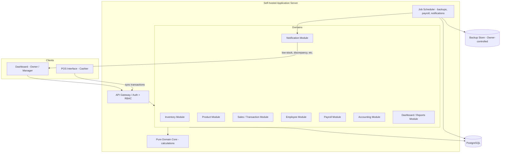

# 00 — Overview: Cashier (Business Owner)

## Purpose

This is the central index and shared context for the **multi-outlet cashier / point-of-sale (POS)** system. The primary user is the **Business Owner**, who monitors sales, manages inventory and products, oversees employees and payroll, and tracks finances across multiple outlets from a centralised dashboard. Outlet Managers oversee daily operations within their assigned outlets, and Cashiers process customer transactions through a dedicated POS interface.

Business data is hosted on infrastructure the Business Owner controls, with automated backup and recovery.

## Spec Index

This documentation set regroups the `cashier-business-owner` spec by domain. Each file is self-contained for its domain and links back to the originating requirements.

| File | Domain | Requirements Covered |
| --- | --- | --- |
| `00-OVERVIEW.md` | Overview, glossary, architecture, cross-cutting design | — |
| `01-INVENTORY.md` | Stock & Inventory Management | Req 1 |
| `02-PRODUCTS.md` | Product Management | Req 2 |
| `03-SALES-TRANSACTIONS.md` | Sales & Transaction Oversight, Reliability/Data Integrity | Req 3, Req 12 |
| `04-POINT-OF-SALE.md` | Point of Sale, Usability | Req 4, Req 15 |
| `05-EMPLOYEES.md` | Employee Management | Req 5 |
| `06-PAYROLL.md` | Payroll Management | Req 6 |
| `07-ACCOUNTING.md` | Accounting & Cash Flow | Req 7 |
| `08-DASHBOARD-REPORTS.md` | Dashboard & Reports | Req 8, Req 11.2 |
| `09-NOTIFICATIONS.md` | Notifications | Req 9, Req 14.4 |
| `10-SECURITY-ACCESS.md` | User Access & Security | Req 10 |
| `11-NONFUNCTIONAL.md` | Performance, Reliability, Scalability, Data Ownership | Req 11, 12, 13, 14 |

## User Roles

The system supports three roles with distinct levels of access:

- **Business_Owner** — Full access to all outlets, transactions, inventory, products, employees, payroll, financial records, and configuration.
- **Outlet_Manager** — Manages daily operations, employees, inventory, and sales within one or more assigned outlets.
- **Cashier** — Processes sales transactions and manages their own cashier shifts within an assigned outlet.

## Glossary

- **System**: The cashier / point-of-sale application described in this document, including its server, database, dashboard, and POS components.
- **POS_Interface**: The component of the System used by Cashiers to process customer transactions.
- **Dashboard**: The centralised component of the System that presents aggregated business metrics and reports.
- **Business_Owner**: A user with full access to all outlets, transactions, inventory, products, employees, payroll, financial records, and configuration.
- **Outlet_Manager**: A user who manages daily operations, employees, inventory, and sales within one or more assigned outlets.
- **Cashier**: A user who processes sales transactions and manages their own cashier shifts within an assigned outlet.
- **Outlet**: A physical business location that holds its own stock, employees, transactions, and cash balances.
- **Stock_Item**: A quantity of a physical good held in inventory at a specific Outlet.
- **Product**: A sellable entity with attributes such as name, category, price, cost, SKU, and barcode, which may be linked to one or more Stock_Items.
- **Product_Variation**: A distinct sellable configuration of a Product (for example, size or colour).
- **Transaction**: A record of a completed or attempted sale, including products, quantities, prices, discounts, payment methods, and the Cashier who processed it.
- **Refund**: A reversal of a previously completed Transaction, in full or in part.
- **Shift**: A period during which a Cashier processes transactions, bounded by a recorded opening cash balance and a recorded closing cash balance.
- **QRIS**: A standardised Indonesian QR-code payment method supported by the System.
- **Payroll_Record**: A record of salary, allowances, bonuses, overtime, and deductions calculated for an employee over a pay period.
- **Timesheet**: A record of an employee's clock-in and clock-out events, late arrivals, absences, and overtime for a pay period.
- **Audit_Log**: A chronological record of security-relevant and financially significant operations performed in the System.
- **Low_Stock_Threshold**: The minimum quantity value configured for a Stock_Item at or below which the System raises a low-stock alert.
- **Role**: A named set of permissions assigned to a user (Business_Owner, Outlet_Manager, or Cashier).

## Technology Stack

- **Language / Runtime:** TypeScript on Node.js (shared types between POS client and server; strong typing for money and domain models).
- **Backend framework:** NestJS (modular DI structure maps cleanly onto the requirement domains).
- **Database:** PostgreSQL 15+ with a query builder / ORM (Prisma) for migrations and typed access.
- **POS client:** A single-page web/desktop app (React) with a local persistence queue (IndexedDB) for offline tolerance.
- **Background jobs:** A scheduler (e.g., BullMQ on Redis) for automated backups, notification dispatch, and payroll batch runs.
- **Property-based testing:** `fast-check` with the project's test runner (Vitest).

## High-Level Architecture

## Layered Structure

Each domain module is organised into three layers:

1. **Controller / API layer** — handles HTTP, authentication, request validation, and RBAC enforcement. Produces the error responses defined in Error Handling.
2. **Service layer** — orchestrates use cases, manages database transactions, and enforces cross-entity invariants (e.g., stock deduction on sale).
3. **Pure domain core** — side-effect-free functions for all calculations: cart totals and change, payroll, inventory valuation, expected cash balance, discrepancy detection. This layer never touches I/O and is the primary target for property-based tests.

## Key Design Decisions

| Decision | Rationale |
| --- | --- |
| Monolithic modular backend (not microservices) | A single deployable server is simpler to self-host (Req 14.1) and keeps multi-domain transactions (sale + stock + accounting) within one database transaction boundary, directly supporting atomicity (Req 12.3). |
| Relational database (PostgreSQL) with ACID transactions | Financial and inventory correctness depend on serialisable/row-locked writes. A relational engine gives us transactions, unique constraints for idempotency (Req 12.2), and strong referential integrity. |
| Idempotency via a client-supplied `transaction_uid` with a unique constraint | Lets the POS safely retry on a flaky connection (Req 4.10, 12.2) without the server inferring intent. |
| Offline-tolerant POS with server-side sync | The POS confirms locally fast (Req 11.3) and syncs transactions to the central server within the 60s visibility window (Req 3.2). |
| Pure domain layer separated from I/O | Calculation logic (totals, change, payroll, valuation) is written as pure functions so it can be exhaustively property-tested independent of the database. |

## Cross-Cutting Design Priorities

The design prioritises four concerns that recur throughout the requirements:

1. **Transaction integrity and idempotency** — transactions must persist atomically (Requirement 12), and duplicate submissions carrying the same identifier must collapse to a single record (Requirements 4.10, 12.2). See `03-SALES-TRANSACTIONS.md`.
2. **Stock consistency** — selling deducts linked stock, refunding restores it, and concurrent sales must not lose updates or oversell (Requirements 2.6, 3.6, 11.1). See `01-INVENTORY.md`.
3. **Role-based access scoped by outlet** — Business Owners see everything; Managers and Cashiers are confined to assigned outlets (Requirement 10). See `10-SECURITY-ACCESS.md`.
4. **Data ownership and recoverability** — data lives on infrastructure the Business Owner controls, with automated backup and point-in-time restore (Requirement 14). See `11-NONFUNCTIONAL.md`.

## Requirements → Spec File Traceability

| Requirement | Title | Spec File |
| --- | --- | --- |
| 1 | Stock and Inventory Management | `01-INVENTORY.md` |
| 2 | Product Management | `02-PRODUCTS.md` |
| 3 | Sales and Transaction Oversight | `03-SALES-TRANSACTIONS.md` |
| 4 | Point of Sale | `04-POINT-OF-SALE.md` |
| 5 | Employee Management | `05-EMPLOYEES.md` |
| 6 | Payroll Management | `06-PAYROLL.md` |
| 7 | Accounting and Cash Flow | `07-ACCOUNTING.md` |
| 8 | Dashboard and Reports | `08-DASHBOARD-REPORTS.md` |
| 9 | Notifications | `09-NOTIFICATIONS.md` |
| 10 | User Access and Security | `10-SECURITY-ACCESS.md` |
| 11 | Performance and Concurrency | `11-NONFUNCTIONAL.md` (and 11.2 in `08-DASHBOARD-REPORTS.md`) |
| 12 | Reliability and Data Integrity | `03-SALES-TRANSACTIONS.md` (recap in `11-NONFUNCTIONAL.md`) |
| 13 | Scalability | `11-NONFUNCTIONAL.md` |
| 14 | Data Ownership, Backup, and Recovery | `11-NONFUNCTIONAL.md` (14.4 also in `09-NOTIFICATIONS.md`) |
| 15 | Usability | `04-POINT-OF-SALE.md` |
