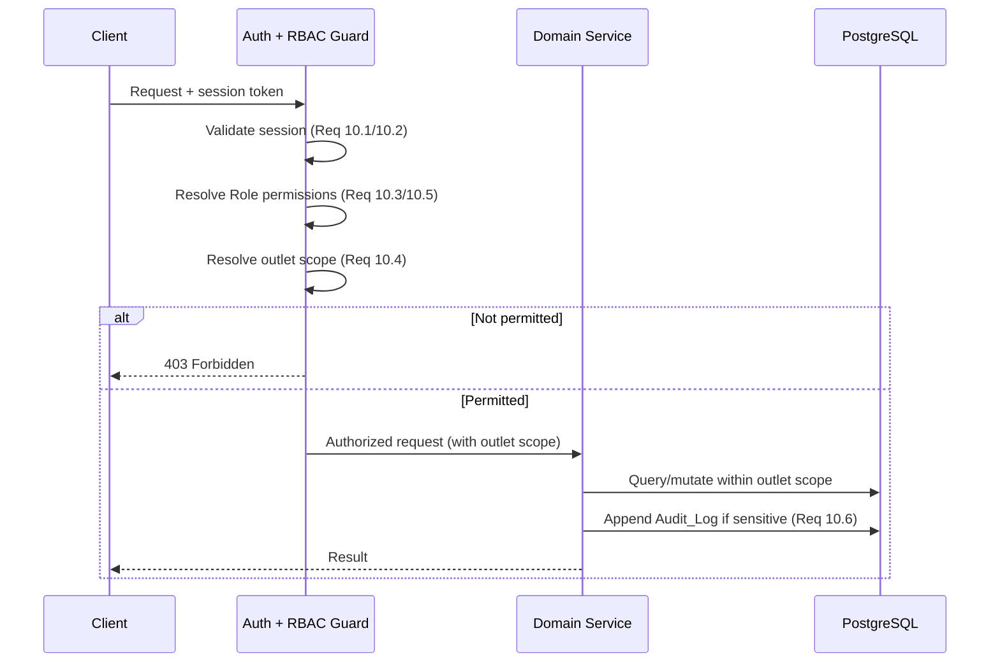

# 10 — User Access & Security

**Requirement 10** — covers all 6 acceptance criteria for authentication, role-based authorisation, outlet-scoped access, permission configuration, and audit logging.

> **User Story:** As a Business Owner, I want secure authentication and role-based access control, so that sensitive business and employee data is protected.

## Acceptance Criteria

1. WHEN a user submits valid credentials, THE System SHALL authenticate the user and establish an authenticated session.
2. IF a user submits invalid credentials, THEN THE System SHALL deny access and return an authentication error.
3. WHEN an authenticated user requests a resource, THE System SHALL grant access only to the operations permitted by the user's Role.
4. WHERE a user holds the Cashier or Outlet_Manager Role, THE System SHALL restrict that user's access to the Outlets assigned to the user.
5. WHEN the Business_Owner configures the permissions for a Role or user, THE System SHALL apply the configured permissions on the user's subsequent requests.
6. WHEN a user performs an operation on a financial record, a payroll record, or a security configuration, THE System SHALL record the operation in the Audit_Log with the originating user, the affected record, and the timestamp.

## Module Interface

```typescript
interface AccessService {
  authenticate(credentials): Promise<Session>;                 // 10.1, 10.2
  authorize(session, resource, action): AuthorizationResult;   // 10.3 (pure decision)
  resolveOutletScope(session): OutletScope;                    // 10.4 (pure)
  setRolePermissions(roleOrUser, permissions): Promise<void>;  // 10.5
  appendAuditLog(entry: AuditEntry): Promise<void>;            // 10.6
}
```

## Request Lifecycle and RBAC

Every authenticated request passes through a central authorization guard:



The guard injects an **outlet scope** (`all` for Business Owner, or an explicit set of outlet IDs for Managers and Cashiers). Every scoped query filters on this set so that outlet isolation is enforced **centrally** rather than per-endpoint.

## Data Model Entities

```typescript
interface AuditLog { id: ID; userId: ID; action: string; recordType: string; recordId: ID; timestamp: Timestamp; }

interface Session { userId: ID; role: Role; outletIds: ID[] | 'ALL'; issuedAt: Timestamp; expiresAt: Timestamp; }
type OutletScope = { kind: 'ALL' } | { kind: 'SET'; outletIds: ID[] };
```

## Notes

- **Centrally-enforced outlet scope (10.4):** The guard resolves an `OutletScope` from the session — `{ kind: 'ALL' }` for the Business Owner, `{ kind: 'SET'; outletIds }` for Managers and Cashiers. Scoped queries filter on this set, so outlet isolation is a single enforcement point instead of being re-implemented per endpoint.
- **Pure authorization decisions:** `authorize(session, resource, action)` and `resolveOutletScope(session)` are side-effect-free decision functions, making them property-test targets.
- **Audit logging (10.6):** Operations on financial records, payroll records, and security configuration append an `AuditLog` entry capturing originating user, affected record, and timestamp. This is relied on by `05-EMPLOYEES.md` (attendance corrections, 5.8) and `07-ACCOUNTING.md` (manual adjustments, 7.7).
